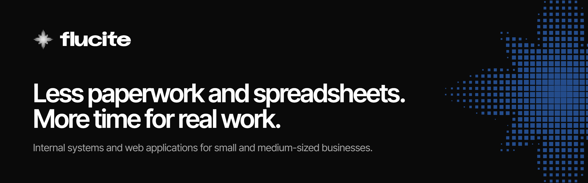
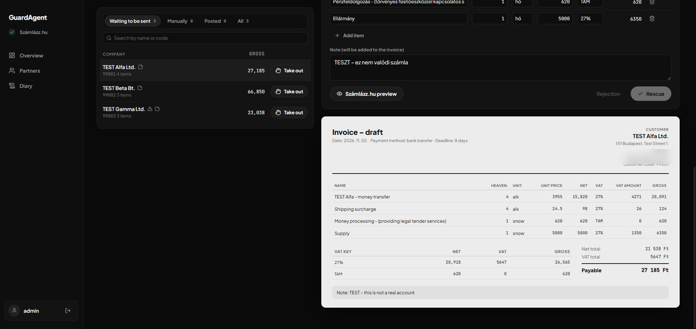
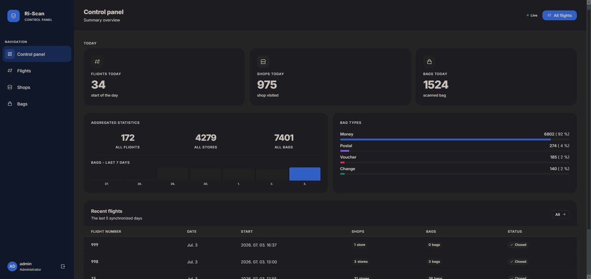

<picture>
  <source media="(prefers-color-scheme: dark)" srcset="assets/banner-dark.png">
  <source media="(prefers-color-scheme: light)" srcset="assets/banner-light.png">
  
</picture>

 

We build internal systems and web applications for small and medium-sized businesses. Software that replaces spreadsheets and paperwork, set up around the way your company already works.

Based in Hungary. Working with companies in any country, in English or Hungarian.

 

## What we do

<table>
  <tr>
    <td width="50%" valign="top">
      <h3>Internal systems</h3>
      Records, reports and invoicing in one place instead of scattered spreadsheets. Connected to the invoicing software you already use.
    </td>
    <td width="50%" valign="top">
      <h3>Web applications</h3>
      Customer portals, booking systems and internal tools that run in the browser, on a computer or a phone, with nothing to install.
    </td>
  </tr>
</table>

 

## Selected work

<table>
  <tr>
    <td width="50%" valign="top">
      
      <h3>Automated invoicing</h3>
      GuardLock Bt.
      
Monthly invoices used to take days to type in by hand. Now two Excel files go in, and every invoice is calculated, checked and issued in one batch.

    </td>
    <td width="50%" valign="top">
      
      <h3>Daily operations system</h3>
      Risec Kft.
      
A cash transport company that tracked each day on paper now sees every route, shop and cash bag on one screen, in real time.

    </td>
  </tr>
</table>

More projects at [flucite.com/references](https://flucite.com/references).

 

## How we work

**We talk.** We look at how your team works today and where most of the time goes. The first call is free.

**You get a written offer.** What we will build, how long it takes and what it costs, before any work starts.

**We build it and stay.** You follow the progress along the way, and we keep looking after the system once it is live.

 

## Get in touch

[flucite.com](https://flucite.com) &nbsp;&nbsp;/&nbsp;&nbsp; [info@flucite.com](mailto:info@flucite.com)
